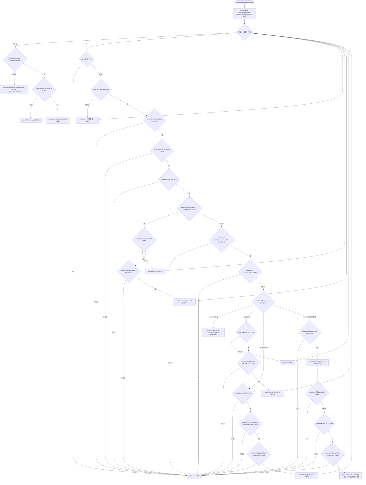

# viewchange-trace
- 날짜: 2026-11-02
- 대상 커밋: SmartBFT 32a628d6 (baseline)
- probe 브랜치: 없음 — 읽기만

> 읽은 저장소: `/Users/liam/Desktop/smartbft/SmartBFT` (HEAD ea1d499d 는 baseline 위에 `.github/PULL_REQUEST_TEMPLATE.md` 한 파일만 추가한 커밋 — `git diff --stat baseline HEAD` 로 확인. 아래 모든 줄 번호는 baseline 과 동일).
> 아래 경로는 모두 `internal/bft/` 기준. `PipelineDepthMax` 플래그는 baseline 에 없음 (`grep -rn PipelineDepth pkg internal` → 0건).

## 체크리스트

### [x] `ViewData` proto (smartbftprotos/messages.proto 65행): `in_flight_proposal` 단수, `in_flight_prepared` bool — 이 둘을 `repeated` 로 바꿀 때 서명(`SignedViewData`)·직렬화 호환성

**현재 정의** — `smartbftprotos/messages.proto:65-77`
```proto
message ViewData {
    uint64 next_view = 1;
    Proposal last_decision = 2;
    repeated Signature last_decision_signatures = 3;
    Proposal in_flight_proposal = 4;
    bool in_flight_prepared = 5;
}
message SignedViewData {
   bytes raw_view_data = 1;
   uint64 signer = 2;
   bytes signature = 3;
}
```
생성 코드의 와이어 태그: `smartbftprotos/messages.pb.go:604-605` — `InFlightProposal ... protobuf:"bytes,4,opt,..."`, `InFlightPrepared ... protobuf:"varint,5,opt,..."`. 재생성은 `smartbftprotos/generate.go` 의 `//go:generate protoc --go_out=paths=source_relative:. messages.proto`.

**서명이 걸리는 대상은 바이트열이다.**
- `viewchanger.go:478-479` — `vdBytes := MarshalOrPanic(vd); sig := v.Signer.Sign(vdBytes)`. `MarshalOrPanic` 은 `util.go:64-70` 의 단순 `proto.Marshal` 래퍼 (deterministic 옵션 없음).
- 리더는 NewView 를 만들 때 수신한 `SignedViewData` 를 **재직렬화 없이 그대로** 넣는다: `viewchanger.go:803` `signedMsgs = append(signedMsgs, vt.GetViewData())`. 수신 측은 `RawViewData` 를 unmarshal 해서 검증 (`viewchanger.go:992`, `541`, `570`, `827`).
- 따라서 ViewData 의 **스키마가 바뀌어도 서명 검증 로직은 그대로** 유효하다. 서명은 바이트에 대한 것이고, 바이트는 끝까지 보존된다.

**호환성 판단 (와이어 레벨)**
- `Proposal in_flight_proposal = 4` → `repeated Proposal ... = 4` 는 와이어 타입이 동일(길이구분형 2)해서 호환되지만, `bool in_flight_prepared = 5` → `repeated bool` 은 proto3 기본이 packed 라서 와이어 타입이 varint(0) → 길이구분형(2) 으로 바뀜. 구버전 파서는 필드 5 를 unknown 으로 버린다 → **`prepared` 정보가 조용히 사라지는** 가장 나쁜 실패 모드.
- 또 `proposal[i]` 와 `prepared[i]` 를 서로 다른 repeated 필드에 두면 길이 불일치 검증이 필요해진다.

**결정 (초안)**: 필드 4/5 는 그대로 두고 신규 메시지 + 신규 필드를 추가한다.
```proto
message InFlightEntry {
    Proposal proposal = 1;
    bool prepared = 2;
}
message ViewData {
    ...
    Proposal in_flight_proposal = 4;   // W=1 호환: in_flight[0] 과 동일 내용
    bool in_flight_prepared = 5;       // W=1 호환: in_flight[0].prepared
    repeated InFlightEntry in_flight = 6;  // seq 오름차순, 연속
}
```
- `PipelineDepthMax == 1` 이면 필드 6 을 비우고 4/5 만 채워 **baseline 과 바이트 단위로 동일한 ViewData** 를 만든다 (기존 테스트가 `vd` 고정값을 marshal 해서 비교하므로 — `viewchanger_test.go:52-62`).
- 검증 측은 "6 이 비어 있으면 4/5 를 길이 1 리스트로 승격" 하는 어댑터 하나(`inFlightEntries(vd) []*InFlightEntry`)를 두고 아래 모든 함수가 리스트만 본다.
- 비교는 `proto.Equal` 로 하고 있어서 (`viewchanger.go:637`, `890`, `1271`) 엔트리별 `proto.Equal(a.proposal, b.proposal)` 로 바꾸면 된다.

### [x] `prepareViewDataMsg()` 467행, `getInFlight()` 492행: in-flight 제안을 어디서 꺼내오는지 (`View.inFlightProposal`? `State`?)

**출처는 `ViewChanger.InFlight *InFlightData` 이고, `View.inFlightProposal` 이 아니다.**
- `viewchanger.go:469` `inFlightProposal, prepared := v.InFlight.InFlightProposalAndPrepared()` → `util.go:220-229`.
- `InFlightData` 는 단일 슬롯: `util.go:184-192`
  ```go
  type InFlightData struct { lock sync.RWMutex; v *inFlightProposalData }
  type inFlightProposalData struct { proposal *types.Proposal; prepared bool }
  ```
- **누가 쓰는가**: WAL 저장 경로. `state.go:41-47` `PersistedState.Save` 가 `ProposedRecord` 면 `storeProposal` (`state.go:59-68` → `StoreProposal` `util.go:232-239`), `Commit` 면 `storePrepared` (`state.go:70-73` → `StorePrepares` `util.go:242-253`). 즉 View 가 `v.State.Save(...)` 를 호출할 때(`view.go:416` pre-prepare 기록, commit 기록) 부수효과로 채워진다. 복구 시에도 `state.go:162`, `222-223` 에서 같은 함수로 재채움.
- **단일 가정 (수정 필요)**:
  - `util.go:238` `ifp.v = &inFlightProposalData{proposal: &p}` — 두 번째 pre-prepare 의 WAL 기록이 첫 번째를 **덮어쓴다**.
  - `util.go:242-253` `StorePrepares(view, seq uint64)` 는 인자 `view, seq` 를 **사용하지 않고** 현재 슬롯을 prepared=true 로 바꾼다. W≥2 에서는 "어느 seq 가 prepared 됐는지" 구분 불가.
  - `util.go:245` `panic("stored prepares but proposal is not initialized")` — 슬롯이 비어 있으면 패닉. 파이프라인에서 k+2 의 commit 이 k+1 의 pre-prepare 보다 먼저 기록될 일은 없지만, 윈도우 slot 구조로 바꾸면 "해당 seq 슬롯 없음" 으로 조건을 재정의해야 함.
  - `controller.go:695-718` `maybePruneInFlight` 도 단일 `InFlightProposal()` 을 읽어 sync 결과 seq 와 비교 후 `clear()` (717). 윈도우에서는 "seq <= synced seq 인 엔트리만 제거".
- `View` 쪽 `view.go:99 inFlightProposal *types.Proposal` 은 View 내부 상태(`view.go:359` 초기화, `422` 설정, `330`/`446` 읽기)로, ViewChanger 는 이를 직접 읽지 않는다. 단, `commitInFlightProposal` 이 **자기가 만든** in-flight View 에 이 필드를 직접 써 넣는다 (`viewchanger.go:1328`) — 아래 D.6 참고.

**`getInFlight()` 의 필터 (viewchanger.go:492-532)** — 모두 "체크포인트와 비교해 이미 결정된 것은 뺀다" 규칙:
- `493` `inFlight == nil → nil`
- `514-515` 체크포인트가 genesis 면 그대로 반환
- `521-524` `inFlightMetadata.GetLatestSequence() == lastDecisionMetadata.GetLatestSequence()` → `nil // this is not an actual in flight proposal`
- `525-530` `inFlightMetadata.GetLatestSequence()+1 == lastDecisionMetadata.GetLatestSequence() && v.committedDuringViewChange != nil && v.committedDuringViewChange.GetLatestSequence() == lastDecisionMetadata.GetLatestSequence()` → `nil` (뷰 체인지 중 `checkLastDecision` 이 전달해서 하나 앞선 경우, `681` 에서 세팅).
- `497-498`, `510-511` 은 Panicf.
- 윈도우 일반화: `for e in entries: if e.seq <= checkpointSeq { drop }` 로 두 조건이 하나로 합쳐진다. `committedDuringViewChange` 특수 분기(정확히 1 뒤일 때만)는 체크포인트 기준 필터로 흡수된다.

### [x] `checkLastDecision()` 568행: 2f+1 ViewData 중 last_decision 을 고르는 규칙 — 윈도우에서는 "last decision" 이 노드마다 W 범위로 다를 수 있음

**현재 규칙은 "2f+1 중 고른다" 가 아니라 "새 리더 자신의 체크포인트 seq (`mySequence`) 기준 메시지별 필터" 다.** 리더가 ViewData 를 받을 때마다 `validateViewDataMsg` (`534-566`) → `checkLastDecision` (`568-699`) 이 호출된다.
- `580` `mySequence, myLastDecision := v.extractCurrentSequence()`
- `597-603` 보낸 쪽이 genesis: `mySequence > 0` 이면 거절.
- `609-612` `lastDecisionMD.GetViewId() >= vd.GetNextView()` → 거절.
- `616-619` **`lastDecisionMD.GetLatestSequence() > mySequence+1`** → 거절 ("decision in the future ... might not have the right configuration").
- `620-623` `< mySequence` → 거절 (과거).
- `625-643` `== mySequence` → 서명자=발신자 확인, ViewData 서명 검증, `proto.Equal(vd.GetLastDecision(), myLastDecision)` (637).
- `645-648` `!= mySequence+1` → 거절 (방어적; 위 분기들 뒤라 사실상 도달 불가).
- `650-698` **정확히 하나 앞선 경우만** `ValidateLastDecision` (quorum 개 서명 검증, `714-760`) 후 `deliverDecision` (673) 하고 `v.committedDuringViewChange = md` (681), 그 뒤 ViewData 서명 검증.
- 2f+1 모임 후 실제로 "합의 기준 seq" 를 뽑는 곳은 `CheckInFlight` 의 `expectedSequence := maxLastDecisionSequence(messages) + 1` (`852`, `948-966`) — **quorum 안의 최대 last_decision seq + 1** 이 in-flight 로 인정되는 유일한 seq.

**윈도우 영향 (핵심 문제)**: 파이프라인에서는 정직한 노드끼리도 체크포인트가 최대 W 차이날 수 있다 (commit 은 seq 순서로 하므로 "앞선 노드" 는 연속 접두사를 더 많이 커밋한 상태). 그러면
1. 리더보다 2..W 앞선 정직 노드의 ViewData 는 `616` 에서 거절 → 리더가 quorum 을 못 모아 타임아웃 될 수 있다. 특히 **리더 자신이 뒤처진 노드**일 때 그렇다.
2. ViewData 는 last_decision **하나**와 그 서명만 싣기 때문에, 2 이상 앞선 노드가 보낸 메시지로는 리더가 중간 decision(k+1)을 받을 수 없다 → `650-673` 식 "검증 후 전달" 로 따라잡기 불가.
3. `maxLastDecisionSequence+1` 하나만 in-flight 후보 seq 로 보는 `CheckInFlight` 는 윈도우에서 "접두사" 를 표현할 수 없다.

→ 설계 결정은 아래 "결론" 에. 요약: `616` 의 상한을 `mySequence+1` → `mySequence+W` 로 넓히지 않고(중간 decision 을 받을 수 없으므로 안전하게 검증 불가), 대신 ViewData 가 **커밋 접두사 증거**(`last_decision` 하나 + in-flight 리스트)를 싣고, 리더는 `> mySequence+1` 이면 **f+1 명 이상이 같은 주장을 할 때만** `Synchronizer.Sync()` 후 재검증하는 쪽을 1차안으로 둔다. [?] 로 열어둠 — 아래.

### [x] `extractCurrentSequence()` 701행: 새 리더가 재제안할 seq 를 정하는 규칙 → 다중 in-flight 용 "연속 prepared 접두사" 규칙으로 바꿀 지점

- `701-711`: 체크포인트의 `LatestSequence` 와 제안을 반환. genesis 면 `(0, myLastDecision)`.
  ```go
  myLastDesicion, _ := v.Checkpoint.Get()
  if myLastDesicion.Metadata == nil { return 0, myLastDesicion }
  ... return myMetadata.GetLatestSequence(), myLastDesicion
  ```
- 호출 지점 3곳: `580` (checkLastDecision), `975` (validateNewViewMsg), **`1204` (processNewViewMsg, in-flight 커밋 이후)**.
- 새 뷰의 시작 seq 는 `1228` `v.Controller.ViewChanged(v.currView, mySequence+1)` → `controller.go:454-461` → `changeView` → `startView(proposalSequence)` (`controller.go:363`). 즉 **"재제안 seq = (in-flight 커밋을 끝낸 뒤의) 체크포인트 seq + 1"**.
- 이 함수 자체는 바꿀 필요가 없다. `1204` 가 커밋 루프 **뒤에** 체크포인트를 다시 읽기 때문에, 접두사 k+1..k+m 을 순서대로 커밋하면 자연히 `k+m+1` 이 나온다 (체크포인트 갱신은 `Application.Deliver` 경로에 의존 — 테스트에선 app mock 이 `checkpoint.Set` 수행, `viewchanger_test.go:2026-2031`).
- **바꿀 지점은 그 앞의 `CheckInFlight` (851-945)** 다: 단일 `(ok, noInFlight, inFlightProposal)` → "접두사 리스트" 를 돌려줘야 한다. 조건 A1/A2 (`924-928`): `preprepared >= f+1` 그리고 `noArgument >= quorum`, 조건 B (`940`): `noInFlightCount >= quorum`. 단일 seq 전제: `874` `inFlightMetadata.GetLatestSequence() != expectedSequence → noInFlightCount++`, `909`.

### [x] `validateNewViewMsg()` 971행: NewView 검증 — 흐름도

함수 시그니처 `(valid, sync, deliver bool, authenticated map[uint64]*protos.ViewData)` (`971`). 각 SignedViewData 를 **순서대로** 순회하며, `deliver` 를 반환하면 호출자 `processNewViewMsg` 가 **처음부터 다시** 돈다 (`1176-1179` `for calledDeliver { ... = v.validateNewViewMsg(msg) }`). 흐름도는 별도 섹션. in-flight 관련 분기는 각 종착점의 `ValidateInFlight(vd.GetInFlightProposal(), seq)` (`1033`, `1062`, `1083`, `1131`) — 모두 단일 제안에 대해 `seq == lastDecision.seq + 1` 만 확인 (`763-778`, 특히 `774`). 리스트로 바꾸면 "entries[0].seq == last+1 이고 연속, 중복 없음, 길이 ≤ W" 로 확장.

주의할 점:
- `1051-1053` `> mySequence+1` 이면 **즉시** `v.Synchronizer.Sync()` 후 `(true, true, false, nil)` — 리더 쪽(`616`)과 달리 팔로워는 동기화를 택한다. 윈도우에서 정직 노드 간 W 차이가 흔해지면 **sync 가 빈번해질 수 있음** (뷰 체인지 비용 증가). TODO 주석(`1052`) 그대로: sync 후 재검증 경로 없음.
- `1139-1145` 인증된 ViewData 가 quorum 미달이면 `syncForUnauthenticatedNewView` (뷰당 1회, `1165-1172`).
- `1151-1155` 리더 자신의 인증된 ViewData 가 반드시 포함돼야 함.

### [x] `processNewViewMsg()` 1174행, `commitInFlightProposal()` 1252행, `decideInFlight()` 1395행: 새 뷰에서 in-flight 제안을 커밋하는 경로 — 하나만 가정한 곳 전부 표시

`processNewViewMsg` (`1174-1233`)
- `1190` `ok, noInFlight, inFlightProposal, err := CheckInFlight(authenticated, ...)` — **단일 반환값**.
- `1199` `if !noInFlight && !v.commitInFlightProposal(inFlightProposal) { ... return }` — **한 번만 커밋**.
- `1204-1216` 체크포인트를 다시 읽어 `SavedMessage_NewView{ViewId, LatestSequence: mySequence}` WAL 기록.
- `1218-1222` 커밋 중 reconfig 로 stop 됐으면 중단.
- `1228` `ViewChanged(v.currView, mySequence+1)`.

`commitInFlightProposal(proposal *protos.Proposal)` (`1252-1391`) — **전부 단일 전제**
- `1254` `proposal == nil → Panicf`.
- `1263-1280` 체크포인트와 비교:
  - `1268-1276` 같은 seq 면 `proto.Equal(myLastDecision, proposal)` 로 동일성 확인, 다르면 `return false`, 같으면 `return true`.
  - `1277-1279` **`lastDecisionMD.GetLatestSequence() != proposalMD.GetLatestSequence()-1` → `Panicf`** — 정확히 다음 seq 가 아니면 패닉. 접두사 루프에서는 i 번째 엔트리가 체크포인트+1 임을 루프 불변식으로 보장해야 함.
- `1284-1285` `inFlightViewNum := proposalMD.GetViewId()`, `inFlightViewLatestSeq := proposalMD.GetLatestSequence()` — View 하나에 seq 하나.
- `1296-1319` 새 `View{ Number: inFlightViewNum, LeaderID: v.SelfID, ProposalSequence: inFlightViewLatestSeq, Phase: PREPARED, ... }`. `Phase: PREPARED` 이므로 `view.go:290-292` 에서 `lastBroadcastSent` (Commit) 를 재방송하고 `prepared()` (`view.go:329-352`) → `processCommits` 만 돈다.
- `1327` `v.inFlightView = inFlightView` — 구조체 필드도 단일 포인터 (`96 inFlightView *View`).
- `1328-1333` `v.inFlightView.inFlightProposal = &types.Proposal{...}` — View 내부 단일 슬롯에 직접 기록.
- `1335-1336` `inFlightRequests`, `myProposalSig` 단일.
- `1337-1350` `lastBroadcastSent` = **Commit 하나** (`Seq: v.inFlightView.ProposalSequence`).
- `1353-1354` 틱 2회 대기 후 `1357 Start()`.
- `1372-1390` `decideCh` / `syncCh` / 타임아웃(`checkIfTimeout`, 1382) / `stopChan` 중 하나를 기다려 `true|false` 한 번 반환.
- `HandleViewMessage` (`1436-1443`) 는 그 하나의 View 로만 전달. View 는 `view.go:220-231` 에서 `seq == ProposalSequence` 또는 `+1` 만 받고 나머지는 `discoverIfSyncNeeded` → 접두사의 뒤쪽 seq(k+3 이상) Commit 이 먼저 도착하면 **버려지거나 sync 유발**.

`decideInFlight` (`1395-1416`) — `attempt.viewRef.stop()` (1396) 후 `Application.Deliver` 1회, 요청 제거, `decideCh` 1회 신호(`1412-1415`, non-blocking).

### [x] `syncInFlight()` 1424행: in-flight 커밋 실패 시 sync 로 빠지는 조건

- `1424-1433`: in-flight View 가 `Sync` 콜백(`54-65 inFlightAttemptCallbacks.Sync`)을 부르면 `v.Synchronizer.Sync()` 하고 `attempt.syncCh` 에 non-blocking 신호 → `commitInFlightProposal` 의 `1377-1379` 가 `return false` → `processNewViewMsg` `1200-1201` 로그 후 **뷰를 바꾸지 않고 return**.
- View 가 Sync 를 호출하는 조건 (PREPARED 상태의 in-flight View 에서 도달 가능한 것):
  - `view.go:205-217` 리더(=자기 자신, `LeaderID: v.SelfID` 1303)로부터 다른 view 번호 메시지 → `213-214` `msgViewNum > v.Number` 이면 `Sync()`. (테스트 `TestInFlightViewMessageFromItselfWithWrongView` 2190 이 이 경로.)
  - `view.go:807-821` 다른 노드들이 `vote.seq > v.ProposalSequence` 인 쪽에 quorum 투표 → `v.stop(); v.Sync.Sync()`.
  - `view.go:227-230` seq 가 `ProposalSequence`/`+1` 이 아니면 `discoverIfSyncNeeded`.
- 그 외 실패: 타임아웃 `1380-1385`, stop `1386-1389`.
- 윈도우 영향: 접두사 k+1..k+m 을 순차 커밋하는 동안 다른 노드가 이미 k+m 까지 커밋해 `k+m+1` 의 Commit 을 보내면 `view.go:813` 조건상 `vote.seq > ProposalSequence` 로 집계되어 **정상 상황에서도 sync 로 빠질 수 있다**. 루프 설계 시 "접두사 안의 seq 에 대한 투표는 sync 트리거에서 제외" 하거나 in-flight View 를 윈도우 인식형으로 바꿔야 한다. [?] 아래 열린 문제.

### [x] 테스트: `viewchanger_test.go` 에서 in-flight 관련 케이스 목록 — 다중 in-flight 테스트를 추가할 템플릿으로

고정값: `viewchanger_test.go:31-72` — `lastDecision` (seq 1, view 0), `vd` (NextView 1, in-flight 없음), `viewDataMsg1`.

| 테스트 | 줄 | in-flight 관련 서브케이스 / 요지 | 템플릿 용도 |
|---|---|---|---|
| `TestInFlightProposalInViewData` | 1312 | "in flight is nil" / "in flight same as last decision" / "in flight is after last decision" — `InFlightData` 를 주입해 송신 ViewData 의 `GetInFlightProposal()` nil 여부 확인 | `prepareViewDataMsg`+`getInFlight` 리스트화 검증. W 개 StoreProposal 후 길이·연속성·체크포인트 이하 제거 확인 |
| `TestValidateInFlight` | 1526 | "not set" / "metadata is nil" / "unable to unmarshal" / "wrong in flight proposal sequence" / "valid" | 리스트 버전 `ValidateInFlight`: 비연속·중복·길이>W 케이스 추가 |
| `TestCheckInFlightNoProposal` | 1744 | "all without" / "all with old" / "quorum without" / "quorum with an old" / "some with no, some old" / "enough with a different" | 조건 B(접두사 길이 0) |
| `TestCheckInFlightWithProposal` | 1822 | 9 케이스: 전부 prepared / quorum prepared+나머지 none·old·different / 1명만 prepared(f+1 조건) / 아무도 prepared 안 함 / 두 후보로 갈려 quorum 없음 / preprepared 부족 / 어느 쪽도 quorum 못 채움 → `(ok, no, proposal)` 비교 | **핵심 템플릿**. `mutateMessages func([]*protos.ViewData)` 패턴 그대로, 기대값을 `[]*Proposal` 접두사로. 추가 케이스: 접두사 중간(k+2)만 prepared 미달 → k+1 까지만 보존 |
| `TestCommitInFlight` | 1984 | ViewData 2개(prepared) 수신 → NewView 방송 → 틱 2회 → `HandleViewMessage` 로 Commit 2개 주입 → `Deliver` 확인 → `ViewChanged(1, 3)` 확인 (`2129-2132`) | 접두사 m 개를 순차 커밋하는 통합 테스트 템플릿. Commit 주입을 seq 별로 반복, 최종 `ViewChanged(1, k+m+1)` |
| `TestInFlightViewMessageFromItselfWithWrongView` | 2190 | in-flight View 가 자기 자신(리더) 의 잘못된 view 메시지에 패닉하지 않음 | 접두사 루프 중 두 번째 View 에도 동일 보장 |
| `TestCommitWhileHavingInFlight` | 2334 | in-flight seq 가 last decision 보다 낮은 상황 (`committedDuringViewChange` 경로) | 체크포인트 이하 엔트리 제거 |
| `TestDontCommitInFlight` | 2446 | in-flight 없음(조건 B) → 바로 `ViewChanged` | 접두사 길이 0 |
| `TestNewViewOfCurrentViewIsIgnored` | 2783 | "without an in flight proposal" / "with an in flight proposal" | 그대로 |
| `TestViewChangerKeepsRunningAfterInFlightWaiterLeft` | 3048 | waiter 가 떠난 뒤 `decideCh`/`syncCh` 가 막히지 않음 (`1412-1415`, `1429-1432`) | 루프 중 타임아웃 뒤 늦게 오는 Decide 처리 |
| `TestBadViewDataMessage` | 481 | last-decision 분기별 거절 10 케이스 (in-flight 직접 케이스 없음) | `616` 규칙 변경 시 "ahead by 2..W" 케이스 추가 |
| `TestBadNewViewMessage` | 704 | "sync" (1051), "deliver" (1136), "not enough" (1139) 등 9 케이스 | 흐름도 종착점별 |

Helper: `viewDataBySender(messages)` (CheckInFlight 입력 map 생성, 1975 사용).

## validateNewViewMsg 흐름도

`internal/bft/viewchanger.go:971-1159`. 반환 4-튜플 `(valid, sync, deliver, authenticated)`. 호출자 `processNewViewMsg` (1174) 는 `deliver=true` 면 재호출, `valid=false` 또는 `sync=true` 면 return, 아니면 `CheckInFlight(authenticated)` 로 진행.



윈도우 변경점은 네 개의 `ValidateInFlight` 노드(IF0/IFP/IFE/IFD)와 `CMP` 의 `> my+1` 가지다. 나머지 구조는 유지 가능.

## 결론 / 설계 결정

### 수정 함수 목록 (viewchanger 영역)

| 파일:함수 | 줄 | 변경 |
|---|---|---|
| `smartbftprotos/messages.proto` `ViewData` | 65-71 | `InFlightEntry` 추가, `repeated InFlightEntry in_flight = 6`. 4/5 유지 (W=1 바이트 동일) |
| `util.go` `InFlightData` | 184-260 | 단일 슬롯 → `map[seq]*inFlightProposalData` 또는 seq 정렬 슬라이스. `StoreProposal(prop)` 는 seq 키로 삽입, `StorePrepares(view, seq)` 는 **인자를 실제로 사용**해 해당 seq 만 prepared. `clear()` → `clearUpTo(seq)` 추가. 새 접근자 `InFlightEntries() []entry` (seq 오름차순) |
| `viewchanger.go` `prepareViewDataMsg` | 467-490 | 리스트를 `getInFlightEntries` 로 필터 후 필드 6 채움; W=1 이면 4/5 만 |
| `viewchanger.go` `getInFlight` → `getInFlightEntries` | 492-532 | `seq <= checkpointSeq` 제거, 연속성 확인(끊기면 그 앞까지만), 최대 W |
| `viewchanger.go` `ValidateInFlight` | 763-778 | 리스트: `entries[0].seq == last+1`, `entries[i+1].seq == entries[i].seq+1`, `len <= W`, 각 metadata unmarshal |
| `viewchanger.go` `validateViewDataMsg` | 558 | 리스트 버전 호출 |
| `viewchanger.go` `checkLastDecision` | 616 | [?] "ahead by ≥2" 처리 — 아래 열린 문제 1 |
| `viewchanger.go` `CheckInFlight` → `CheckInFlightPrefix` | 851-945 | 아래 의사코드. 반환 `(ok bool, prefix []*protos.Proposal, err)` ; `noInFlight ≡ len(prefix)==0` |
| `viewchanger.go` `validateNewViewMsg` | 1033, 1062, 1083, 1131 | 리스트 `ValidateInFlight`; `1051` 분기는 1차안에서 유지 |
| `viewchanger.go` `processNewViewMsg` | 1190-1202 | `for _, p := range prefix { if !v.commitInFlightProposal(p) { return } }` — 각 반복 전 체크포인트 재확인 |
| `viewchanger.go` `commitInFlightProposal` | 1268-1279 | 유지 가능 (루프 불변식으로 `checkpoint+1 == p.seq` 보장). `1277 Panicf` 는 루프 중 외부 sync 로 체크포인트가 점프한 경우를 위해 "`checkpoint >= p.seq` 면 skip(true)" 로 완화 |
| `viewchanger.go` `commitInFlightProposal` 타임아웃 | 1380-1385 | `checkIfTimeout` 은 `startViewChangeTime` 기준이므로 루프 전체에 걸쳐 동작 — 변경 없음, 단 W 배 시간 필요성은 열린 문제 3 |
| `controller.go` `maybePruneInFlight` | 695-718 | `clear()` → `clearUpTo(syncedSeq)` |
| `state.go` `recoverProposed`/`recoverPrepared` | 153-247 | (섹션 외, 공유 의존) 마지막 2개 레코드만 보는 가정 — WAL 섹션 담당자에게 이관 |
| `viewchanger_test.go` | 위 표 | `TestCheckInFlightWithProposal`, `TestCommitInFlight` 를 접두사 버전으로 복제 |

### 새 복구 규칙 의사코드

```
// 송신측 (모든 노드, prepareViewDataMsg)
entries := InFlight.InFlightEntries()                 // seq 오름차순
ck := checkpoint.seq
out := []
for e in entries:
    if e.seq <= ck: continue                          // 이미 결정됨 (getInFlight 521-530 통합)
    if len(out) > 0 && e.seq != out[-1].seq+1: break  // 연속성 끊김 → 그 뒤는 보내지 않음
    if len(out) == 0 && e.seq != ck+1: break          // 첫 엔트리는 반드시 ck+1
    out.append({proposal: e.proposal, prepared: e.prepared})
    if len(out) == W: break
vd.in_flight = out ; (W==1 이면 vd.in_flight_proposal/prepared = out[0])

// 수신측 공통 검증 (ValidateInFlight, 리스트)
require entries[0].seq == lastDecision.seq+1
require entries[i+1].seq == entries[i].seq+1   (i 전부)
require len(entries) <= W

// 새 리더 / NewView 수신자 (CheckInFlightPrefix; CheckInFlight 851-945 일반화)
base := maxLastDecisionSequence(messages)              // 948-966 그대로
prefix := []
for s := base+1 ; ; s++ :
    // 단일 seq s 에 대해 기존 조건 A/B 를 그대로 적용
    candidates := distinct proposals p with ∃vd: vd.entry(s)==p && vd.entry(s).prepared
    for p in candidates:
        preprepared := #{vd : vd.entry(s) == p}                                   // A2 ≥ f+1
        noArgument  := #{vd : vd.entry(s) == nil || vd.entry(s).seq != s || vd.entry(s) == p}  // A1 ≥ quorum
        if preprepared >= f+1 && noArgument >= quorum: agreed = p ; break
    if agreed != nil:
        prefix.append(agreed) ; continue                                          // 조건 A: 보존
    noInFlight := #{vd : vd.entry(s) == nil || !vd.entry(s).prepared}
    if noInFlight >= quorum: break                                               // 조건 B: 여기서 끊고 뒤는 폐기
    return ok=false                                                                // 어느 쪽도 못 채움 → 기존과 동일 (944)
return ok=true, prefix

// processNewViewMsg (1190-1202 교체)
ok, prefix := CheckInFlightPrefix(authenticated)
if !ok: return
for p in prefix:
    ck := checkpoint.seq
    if p.seq <= ck: continue                           // 루프 중 sync/deliver 로 이미 커밋
    if p.seq != ck+1: return                           // 불변식 위반 (sync 로 점프) → 뷰 변경 포기, 재시도 대기
    if !commitInFlightProposal(p): return              // 기존과 동일: 타임아웃/sync/stop → 뷰 안 바꿈
mySequence := checkpoint.seq                           // 1204 그대로
ViewChanged(currView, mySequence+1)                    // 1228 그대로
```

여기서 `vd.entry(s)` 는 "그 ViewData 의 in_flight 리스트에서 seq==s 인 엔트리, 없으면 nil". `s` 가 리스트 범위를 벗어나 nil 이면 기존 코드의 `vd.GetInFlightProposal()==nil` (857) 과 같은 취급(noInFlight 및 noArgument 에 가산).

### 안전성 논증 초안

주장: 새 뷰에서 (1) 이전 뷰에서 어떤 정직 노드가 **커밋했을 가능성이 있는** seq 는 모두 같은 값으로 보존되고, (2) 그렇지 않은 seq 는 폐기되어도 안전하다.

1. **기존 단일 규칙의 불변식**: seq s 에 대해 정직 노드가 s 를 커밋했다면 그 노드는 2f+1 개 Commit 을 봤고, 그중 ≥ f+1 개는 정직 노드가 보낸 것이며 정직 노드는 Commit 전에 자신의 WAL 에 pre-prepare+commit 을 기록(`view.go:416`, 이후 Commit 저장 → `StorePrepares`)하므로 `prepared=true` 상태로 ViewData 에 싣는다. quorum(2f+1) 개 ViewData 중 그 f+1 과 적어도 1개는 겹치고… 정확히는 기존 코드의 A1 (`noArgument ≥ quorum`) + A2 (`preprepared ≥ f+1`) 조합과 B (`noInFlight ≥ quorum`) 가 상호 배타적임이 `CheckInFlight` 의 안전성 근거다 (A 가 성립하는 p 가 있으면 B 는 성립 불가: prepared 를 든 정직 노드가 f+1 명 이상이면 noInFlight 는 최대 (2f+1) − (f+1) + f = 2f < 2f+1).
2. **seq 별 독립 적용**: 파이프라인에서도 seq s 의 Prepare/Commit quorum 은 s 하나에 대한 투표이므로(`view.go:813` 는 `(view, seq)` 로 집계), 위 불변식은 **각 s 에 대해 독립적으로** 성립한다. 따라서 `CheckInFlightPrefix` 가 s 마다 기존 A/B 판정을 그대로 돌리면 "s 를 어떤 정직 노드가 커밋했을 수 있다 ⇒ A 성립 ⇒ 보존" 이 seq 마다 유지된다.
3. **접두사에서 끊는 이유 (폐기의 안전성)**: 커밋은 seq 순서로 적용된다(`view.go:856-862 decide → startNextSeq`, 체크포인트는 단조). 어떤 정직 노드도 s 를 커밋하지 않았다면(조건 B) s+1 이상도 커밋한 정직 노드는 없다 — s+1 을 커밋했다는 것은 s 를 먼저 커밋했다는 뜻이기 때문. 따라서 B 가 처음 성립하는 s 이후를 폐기해도 "커밋됐을 수 있는 값" 을 버리는 일은 없다. 폐기된 요청은 풀에 남아 새 리더가 재제안한다(기존과 동일).
4. **보존 값의 유일성**: 같은 (view, seq) 에 대해 서로 다른 두 제안이 모두 f+1 정직 preprepared 를 가질 수 없다(동일 뷰·seq 에 정직 노드는 한 번만 Prepare). 뷰가 다른 경우는 ViewData 의 제안이 가장 최근 뷰의 것이므로 기존 로직(`proto.Equal` 비교, 메타데이터에 view_id 포함)과 동일하게 처리된다.
5. **라이브니스 측 비용**: 접두사 커밋은 `commitInFlightProposal` 을 m 번 순차 실행 → 각각 Commit 재방송·quorum 대기. 타임아웃(`checkIfTimeout`)은 뷰 체인지 시작 시각 기준이라 m 이 커지면 실패 확률이 커진다 (열린 문제 3).
6. **W=1 회귀**: 위 규칙은 W=1 에서 `len(prefix) ≤ 1` 이 되어 기존 A/B 와 정확히 같은 결과를 내고, ViewData 바이트도 동일하다.

## 열린 문제

1. **[?] `checkLastDecision` 616 (`> mySequence+1` 거절) 과 `validateNewViewMsg` 1051 (`> mySequence+1` 즉시 sync)** — 윈도우에서는 정직 노드 간 체크포인트 차이가 최대 W 이므로, 뒤처진 새 리더는 앞선 정직 노드의 ViewData 를 모두 거절해 quorum 을 못 채운다. ViewData 가 last_decision 하나만 싣는 구조라 중간 decision 을 받아 검증·전달하는 `650-673` 경로를 W 로 확장할 수 없다. 1차안: 리더가 `> my+1` 메시지를 보류 집계해 **f+1 명이 ≥ my+2 를 주장하면** `Synchronizer.Sync()` 후 체크포인트를 다시 읽어 보류 메시지를 재검증. 대안: ViewData 에 `repeated Proposal recent_decisions` 를 추가(크기 비용, 서명 검증 비용 W 배). 주석 `587-589` 의 "sender might be malicious 라 sync 안 함" 원칙과 충돌하므로 결정 필요. 코드만으로는 어느 쪽이 맞는지 판단 불가.
2. **[?] in-flight View 의 sync 트리거 (`view.go:813-820`, `227-230`)** — 접두사 k+1..k+m 을 순차 커밋하는 동안 더 앞선 노드의 `k+m+1` Commit 이 `vote.seq > ProposalSequence` 로 집계되어 정상 상황에서 `syncInFlight` 로 빠질 수 있다. 접두사 루프에 들어가기 전 `v.inFlightView` 가 "앞으로 커밋할 seq 집합" 을 알도록 하거나, 파이프라인용 View(다른 섹션)가 완성되면 View 하나에 접두사 전체를 넘기는 방식으로 바꿔야 한다. View 내부 변경이라 본 섹션 범위 밖.
3. **[?] 타임아웃 예산** — `commitInFlightProposal` 은 매 호출마다 `<-v.Ticker` 2회(1353-1354)를 소비하고 `checkIfTimeout(now)` (1382) 는 `startViewChangeTime` 기준. 접두사 m 개면 최소 2m 틱 + m 회 quorum 대기. `ViewChangeTimeout` 을 W 에 비례해 늘릴지, 접두사 하나 커밋마다 타이머를 재시작할지 결정 필요 (후자는 바이잔틴 리더가 가짜 접두사로 시간을 끄는 공격면을 넓힘).
4. **[?] WAL 복구 (`state.go:132-138`, `recoverPrepared` 185-199)** — 마지막 레코드 1~2개만 보고 `InFlightData` 를 재구성. W≥2 에서는 마지막 pre-prepare 외의 in-flight 가 복구되지 않아 재시작 노드의 ViewData 에서 빠진다(안전성은 유지 — 그 노드가 "prepared 안 함" 으로 보일 뿐 — 하지만 조건 A 를 채우는 정직 노드 수가 줄어 라이브니스 저하). WAL 섹션과 조정 필요.
5. **[?] `committedDuringViewChange` (125, 681, 525-530)** — 단일 `ViewMetadata`. 체크포인트 기준 필터로 흡수하면 제거 가능해 보이나, `TestCommitWhileHavingInFlight` (2334) 가 이 분기를 직접 검증하므로 제거 시 테스트 의미를 다시 정의해야 함.
6. **[?] `StorePrepares` 가 commit 기록 시점에 호출됨 (`state.go:45-47`)** — 즉 "prepared" 플래그는 노드가 **Commit 을 WAL 에 쓴 시점**에 세워진다. 파이프라인 View 가 seq 별 Commit 을 어떤 순서로 WAL 에 쓰는지에 따라 `InFlightData` 슬롯 갱신 순서가 달라지므로, 키를 `(view, seq)` 로 두는 것이 안전하다 — View 섹션 담당자와 확인 필요.
